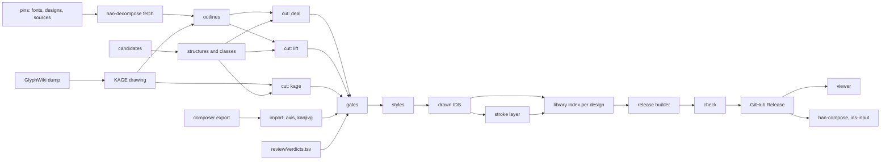

# han-decompose — design

Status, 2026-11-16: release v0.1.0 (2026-11-15) and the viewer are built on format 1. This
document describes format 2 and the work that leads to it (section 7). Section 9 lists what has
been decided.

han-decompose maps the geometry of real fonts to IDS components, and later to strokes. For each
character it covers as many ways of decomposing it as the pinned fonts support: every structure
that some font's glyph divides into, and for each glyph which contours belong to which component.
Every component is a set of contours the font already draws; only the stroke layer cuts a
contour at a seam, and marks each such stroke. Outside descriptions
are candidate structures only; the release carries han-decompose's own descriptions,
in one notation: per character the structures that fit some font, and per glyph a drawn IDS that
names the shape each part has there. The same record serves three uses: a host library for
composition, a variant library of component and character forms, and a reviewed data set for
testing cutters.

Code is MIT. Label data is CC0-1.0. Outlines keep the licence of the font they came from, in files
of their own. [`licensing.md`](licensing.md) says which file is under which terms.

## 1. Findings that shape the design

1. **Three cutters exist and address ink three ways.** The ids-input cutters (`build_donor_parts.py`,
   `build_mountain_instances.py`, `build_custom_cuts.py`) simplify the glyph with skia-pathops and
   work on untouching pieces, writing the simplified paths out. han-compose's cutter (`Composer._cut`,
   `kanjivg_cuts.py`) works on the font's raw contours and its export writes a cut as indices into
   the host glyph's contour list (`c.k` in `web_export.cut_record`). `build_custom_cuts.py` already
   maps pieces back to raw contours (`own()`, by half-area overlap) to match the export.
2. **Raw contours are the finer grain, and in the variable Noto faces much finer.** Measured on 1,500
   random Han glyphs per face (seed 1, 2026-11-15, the pinned fonts): simplification lowers the contour count
   in 1,474 glyphs of Noto Sans CJK JP VF 2.004 and 1,491 of Noto Serif CJK JP VF 2.003, where
   strokes are drawn as overlapping contours; in Plangothic P1 it lowers it in 28 and in Jigmo2 in 33.
   A piece is always a union of whole raw contours, so every existing cut can be written as a set
   of contour indices, and han-compose can cut inside a piece the ids-input cutters must refuse.
3. **The export's host entry mixes neutral facts with composer-specific ones.** Host, operator,
   operand index, box, frame, gap and contour set are facts about the cut. Rank `r`, sibling ink
   `si`, `v`, `j`, the 71 shape features `f` and the usual boxes `u` belong to one layout model
   version. `build_custom_cuts.py` re-implements the second group (`slot`, `Part.box`,
   `Contour.length`, `compose_layout.shape`, the int16 quarter-unit encoding) outside han-compose.
4. **Verdict keys are lossy.** The gallery keys a verdict by style, component and host; the donor
   review page by character. Neither names the contour set judged, so a rebuild that changes the
   cut silently inherits the verdict.
5. **Only outlines carry a licence that reaches the data.** Outlines are font software: SIL OFL
   1.1 (Noto, Plangothic, GenZui, Kureedo, Zhuque), Arphic Public License (BabelStone Han PUA),
   and GlyphWiki's licence for the glyphs drawn from its data. How a character divides is a fact about the character. The description
   tables that state it relicense one another along a chain (CHISE's CDP data, CHISE IDS,
   BabelStone, zi.tools), so their terms are no basis for terms on a mapping built here. KanjiVG
   guides some cuts: its stroke groups say which contours go together, and the cut is contours of
   the font.
6. **Gates are calibrated for one component.** The filled gate (1 − IoU ≥ 0.6081 at 64 px) and the
   skeleton gate (one-sided cut→reference distance ≥ 0.0499 at 128 px, no pruning) were tuned on
   山 (44 bad and 164 good hand labels in `analysis/mountain-fit/labels.json`, 55 confirmed bad in
   the sweep). The 口 survey applies 山's thresholds unchanged and refuses 4,626 instances; its
   false-refusal rate is unmeasured.
7. **Read per source, a right structure is refused for its spelling.** In v0.1.0, 社 in Noto Sans
   CJK JP is cut under BabelStone's `⿰礻土` and refused as `unlike-element` under `⿰示土`, the
   spelling BabelStone gives for K and P and the one CHISE and zi.tools give. Across the three
   sources, 1,836 skipped rows are `unlike-element` on a description that starts with `⿰示`.
   The structure was right; the template compared was 示 where the glyph draws 礻.
8. **The same text recurs across tables.** ids-input's corpus (`data/ids-corpus.json.gz`,
   SHA-256 `b6a3cac5…`) holds 211,319 description rows; 78,580 subject-and-text pairs occur more
   than once (社 `⿰示土` once from BabelStone's K and P line and once from CHISE). Cutting per
   source cuts each of those again.
9. **One drawing ships under several names.** Noto Sans CJK and Source Han Sans are one design;
   GenZui takes its ideographs point for point from Noto; Sukima Gothic is built on Source Han
   Sans; Plangothic supplements Source Han Sans with glyphs of its own. The `sans` and `serif` chains of format 1 mix designs (Noto Serif CJK JP then
   Jigmo), so a library could hold a Noto cut and a Jigmo cut of one component as if one font drew
   both. Section 2.8 gives the evidence.
10. **GlyphWiki keeps its divisions.** A GlyphWiki glyph is often a list of component glyphs placed
    in boxes, drawn by the KAGE engine. GlyphWiki's API on
    2026-11-16: `u793e` (社) is `99:0:0:0:0:200:200:u793e-j`, and `u793e-j` is
    `99:0:0:0:0:180:200:u793b-01$99:0:0:64:0:197:200:u571f-j`: the left form of 礻 (`u793b-01`)
    in x 0–180 and 土 (`u571f-j`) in x 64–197. `u793a-01`, the left form of 示, is strokes only.
    Jigmo, a font built from GlyphWiki, joins the strokes into one outline (its README names
    Clipper), which loses both the division and the strokes. Drawn from the data directly, each
    stroke is its own group of polygons and each group belongs to one placed component.

## 2. Data model

### 2.1 Vocabulary

| Term | Meaning |
|---|---|
| font | One pinned font file at one named instance (`wght=400` for a variable font). |
| design | A family of fonts that draw with the same outlines (section 2.8). |
| chain | The fonts of one design in coverage order: a glyph is taken from the first that draws it. |
| glyph | One glyph of a font, selected by code point, variation sequence or glyph id. |
| contour | One closed contour of the glyph, in the font's own order. Contours may overlap. |
| piece | A boundary of the merged outline with the counters directly inside it, as the contours that draw it (2.3). Derived, stored per glyph. |
| candidate | An IDS an outside table gives for a character, read only as a structure to try (section 2.4). |
| class | Components that are one thing in different shapes, under a canonical member: 示 for 示, 礻, ⺬, ⺭, 𱍐. |
| structure | An operator tree in one notation, every component written as its class's canonical member. Candidates with one structure are cut once. A character's published descriptions are the structures that fit some font. |
| style | The member of a class a cut is drawn as, in a given font. |
| layer | A contour set with its component: the whole glyph, or a cut opened into its own parts. |
| alternative | One structure of a layer's component. A layer has as many as fit its contours. |
| reading | One alternative applied to one layer: which of its contours go to which operands. |
| cut | One node of a reading: a component, its path, its contour set, its evidence, checks and style. |
| stroke | One stroke of a leaf cut, with its type: whole contours, or an outline cut at seams (2.10). |
| drawn IDS | Per glyph and structure: the accepted reading written with each node's style. 社 in Noto Sans CJK JP is `⿰礻土`. |
| form | A cut seen as a drawing of its component. One per class, style and design is marked as chosen. |
| library | For a class and a design, its cuts grouped by style and place. |
| verdict | A reviewer's Right or Wrong on one cut with one exact contour set, or on one cut's style. |

### 2.2 Identifiers

All identifiers are strings, stable across rebuilds while their inputs are unchanged.

**Font** — `<family-slug>@<version>`: `noto-sans-cjk-jp@2.004`, `noto-serif-cjk-jp@2.003`,
`plangothic-p1@2.9.5795`, `plangothic-p2@2.9.5795`, `babelstone-han-pua@1.472`, and
`glyphwiki@20261115` for the GlyphWiki dump of that date. Each face of a collection is a font with a
slug of its own. The registry row holds file name, URL, SHA-256, name-table version string,
instance, units per em, licence, copyright line, reserved font names, style (`sans`, `serif`,
`kaisho`, `fangsong`) and design. GlyphWiki's row holds the dump's address, date and digest and the
KAGE engine's commit instead of a font file.

**Design** — a slug: `source-han-sans`, `plangothic`, `source-han-serif`, `glyphwiki`, `ipamj`,
`babelstone-han`.
Its registry row holds the fonts in coverage order (the chain) and the evidence for each font's
membership.

**Glyph** — `<font>/<selector>`: `U+50AC`, `U+845B.E0100` (variation sequence), `gid.1234`
(unencoded glyph), `name.u793e-j` (a GlyphWiki glyph by its name). Region-specific drawings are
separate fonts (JP, TC), so no locale selector; GlyphWiki's region glyphs are reached by name.

**Input** — a short slug in `pins/sources.json` for a table the build reads: `ids-corpus`,
`kanjivg`, `adobe-japan1`, `unihan`. Each row holds name, URL, pin (release, commit
or file date), SHA-256 per file, retrieval date and what limits it. Inputs are cited in the docs;
the release data names none of them.

**Structure** — `s.<h8>`, `h8` being the first 8 hex digits of the SHA-256 of the structure text:
社 tried as `⿰示土` and as `⿰礻土` is the structure `⿰示土`, `s.0a1c0fdb`.

**Notation.** Structures and drawn IDS are Unicode IDS: ideographic description characters, the
variation indicator `〾`, and components written as characters. A component no code point names is
one token between `&` and `;`, so it never reads as inner nodes: its own IDS where any input gives
one (`&⿸⿹丅丿丨;`), and otherwise its identifier in ids-input's component ledger (`&X-00777;`).
`⿰&⿸⿹丅丿丨;土` is a two-operand structure whose left leaf is that shape. The names inputs give
such a component (`{42}`, `&CDP-8958;`, `#(丿𠃊)`) are resolved through ids-input's ledger when
candidates are read and are not published.

**Component** — a typed reference, written compactly:

| Kind | Reference | Written as | Value |
|---|---|---|---|
| character | `u:5C71`, `u:845B.E0100` | 山 | Hex code point, optional variation selector. |
| subtree | `ids:⿸⿹丅丿丨` | `&⿸⿹丅丿丨;` | A component no code point names, as its IDS. |
| ledger | `x:X-00777` | `&X-00777;` | An unencoded component with no IDS of its own. |
| Adobe-Japan1 CID | `aj1:1815` | — | A glyph variant reached through `glyph-of`. |

Relations between components other than class membership live in `components.tsv`, one row
per relation, each with its basis and tier:

- `aj1:1815` `glyph-of` `u:5F62` (basis: Adobe-Japan1 CID order, CIDs 1125–7477 follow JIS X 0208
  kanji order; tier `derived`). Cuts of the CID's glyph are then listed as glyph variants of 形.
- `x:X-00777` `equivalent` `u:2E9D` (basis: the same shape, verified on more than one character;
  tier `derived`). A candidate naming that ledger component is read with ⺝.

ids-input's component registry holds 164 `&AJ1-NNNNN;` entities. Adobe's own table (adobe-type-tools/Adobe-Japan1
`aj17-kanji.txt`, version 2023-01-24, Ken Lunde and Masataka Hattori) maps every one of them: 118 are
the base glyph of a JIS X 0208 character (field 2, e.g. 1815 形 23-33, 1829 系, 2014 耕), 45 are later
Adobe-Japan1 additions that map to their own code point in the UniJIS CMap (13701 旣, 16955 灵), and 1
is an IVS (13763 = 工 U+E0101). So `glyph-of` rows can be generated from that table for all 164; the
table is pinned by commit and digest like the fonts.

**Cut** — `<glyph>~<step>~<step>…`, one step per layer from the glyph down, each step
`<structure h8>-<method>:<path>`, so readings of one structure by different methods (`kage`,
`deal`, `axis`) stand side by side; one of them is marked chosen. 山 in 催, read as `⿰亻崔` and then 崔 as `⿱山隹`:
`noto-sans-cjk-jp@2.004/U+50AC~9d9dea39-deal:1~a674f7d6-deal:0`. A path inside one step is the
operand indices of that alternative joined by dots; a reading's root is `-`. A cut also carries
`sig`, the first 8 hex digits of the SHA-256 of its class reference and its sorted contour
indices; `id` + `sig` is what a verdict binds to.

### 2.3 Outlines

One record per glyph, in files that hold a single font:

- `contours`: the glyph's contours in font order after composites are decomposed, each
  `[commands, points]`. Commands use han-compose's letters: `M`, `L`, `Q<n>` (a TrueType quadratic
  run of n points), `Q<n>*` (a whole contour without an on-curve point), plus `C` for a cubic. Curves stay as the
  font has them.
- `points`: flat integers, x and y interleaved, in hundredths of a unit on a 1000-unit em, y up.
  Every existing consumer works on that em; the font's own `upem` is in the registry. Trade-off:
  a font whose em is not 1000 (BabelStone Han PUA, 1024) is rounded by at most 0.005 unit.
  GlyphWiki's 200-unit square scales by 5 exactly.
- `pieces`: the piece partition as lists of contour indices, so no consumer needs boolean
  operations. Rule, as `pieces.py` implements it: the contours are merged into one outline; each
  boundary that an even number of others enclose is a piece, with the counters directly inside it
  cut out, so an island inside a counter (回) is a piece of its own. A contour belongs to the
  smallest piece whose boundary encloses it, else to the piece it shares most ink with. Pieces
  that one contour runs through, meeting only at a point, are joined into one, since no set of
  whole contours tells them apart.
- `box`, `advance`.

Only glyphs that a reading, a skipped attempt or a reference names are written. Whole-font dumps are a non-goal.

### 2.4 Candidates

Outside descriptions are where structures to try come from. The build reads one table of them:
ids-input's `data/ids-corpus.json.gz`, fixed by commit and SHA-256 in `pins/sources.json` so a
build can be repeated. It is read, never bundled or redistributed. It already merges BabelStone IDS
and the CHISE IDS files; ids-input adds to it before format 2 is built (phase 6):

- Yi Bai's zi.tools rows, all three levels.
- ids-input's own rows: `ids-project.tsv`, `custom-ids.tsv`, and the computed character-first
  descriptions that `structure()` puts first in the workshop (`src/adapter/babelstone.js`).
- Class rows in its `equivalences` table (section 2.5).

Every candidate is rewritten in the notation of 2.2 and reduced to its structure; each structure is
tried once per glyph. Which table gave a candidate, its regions and its spelling are not carried
into the data: a structure is published because a font's glyph divides that way, and the drawn IDS
says how the font draws it. Cut files are one per font and block; the flat tables hold every
font, one row per cut with its `font`.

### 2.5 Classes and styles

**What a description claims.** A description says how a character divides: its operators, their
nesting and how many operands each has. Which drawn shape a component takes is the font's
business. 社 is `⿰示土` in one source and `⿰礻土` in another; both say the same division, and a
font may draw either shape. So the cutter accepts a reading when the structure fits the glyph,
compares each node with every member of its component's class, and records which member it looks
like as the cut's style. `unlike-element` remains for a node unlike every member.

**Membership is stated.** A class row is `member` → `target`, with a basis, an optional place and
a tier. Rows read from tables live in ids-input's corpus `equivalences` table under the new kind
`class-member`, beside the existing alignment rows. The project's own rows live in
`review/classes.tsv`, each with its reviewer, date and note; a reviewed pair needs no outside
table. The bases:

| Basis | From | Tier | Examples |
|---|---|---|---|
| `radical-form` | Unicode `EquivalentUnifiedIdeograph.txt` 18.0.0, as copied into ids-input `component-forms.tsv` | `source` | ⺬ → 示, ⺭ → 礻, ⺼ → 肉, ⻏ → 邑, ⻖ → 阝 |
| `positional-form` | cjkvi-variants `radical-variants.txt` at e4f1da2, same copy, with its place where it states one | `source` | 礻 → 示, 氵 → 水 (left), 扌 → 手 (left), 忄 → 心, 亻 → 人 (left), 糹 纟 → 糸 (left), 訁 讠 → 言 (left), 釒 钅 → 金 (left), 飠 饣 → 食 (left), 衤 → 衣 (left), 王 𤣩 → 玉, 刂 → 刀 (right), 犭 → 犬 (left), 阝 → 邑 (right) |
| `unifiable-variant` | IRG N2978 (UCV and NUCV lists, version 2026-10-20), via ids-input `ucv.json` | `source` | entry 362: 示 and 礻 unifiable, criterion JIS 161 and HYDCD 19 |
| `radical-index` | Unihan `kRSUnicode` with no residual strokes | `derived` | 𱍐 (U+31350) is `113.0`: radical 示 itself |
| `alignment` | the corpus's own alignment, one source writing the member where another writes the target for the same character | `derived` | the 62 existing number–entity pairs |
| `editorial` | `review/classes.tsv`, a reviewer's row with name, date and note | `editorial` | `&⿸⿹丅丿丨;` → 示, reviewed 2026-11-16: 示 drawn without its first 一 |

The build rule: a member resolves by following its rows to a target that is no member of anything,
the class's canonical member (⺭ → 礻 → 示). A row with a place applies only at that place: 阝 is
邑's on the right, and outside that place it is itself. A member that resolves to two canonicals
at one place joins neither, and the build reports it. A pair with no row, from a table or
editorial, is never merged: the two components stay apart, and a node drawn in the other shape is refused as
`unlike-element` as before.

**Styles.** Each cut of a class member gets a `style`: the member its drawing matches, named by
an existing code point or IDS. Styles are read off the glyph:

1. A `kage` cut (section 2.6) takes its style from the GlyphWiki component it was placed as:
   `u793b-01` is 礻's left form, so the style is 礻.
2. Otherwise the cut is compared with a reference drawing of each member: the member's own glyph
   in the same design, and the `kage` cuts of that member. The best match above a limit gives the
   style, tier `machine`.
3. Cuts that match no reference are clustered per class and design; a cluster gets a style once a
   reviewer names it, tier `reviewed`.

**示, worked through.** ids-input checked 193 characters whose sources write `⿰示…` against MingLiU
ExtB glyphs: 185 draw 礻, seven draw 𱍐 (𥘦 𥘽 𥙌 𥙝 𥙼 𥛖 𥜟) and 𢼗 draws the full 示
(ids-input PR #832, 2026-11-09). Cutting their left operands met three row problems (PR #848,
2026-11-09) and needed the middle-line rule (PR #850, 2026-11-10); there the cutter already tried 示,
礻 and 𱍐 as templates in turn, which is this design's class comparison at one place. Here those
193 are one structure each: the cut of the left operand belongs to class 示, its style says 礻, 𱍐
or 示, and the drawn IDS writes it.

### 2.6 Layers, readings and cuts

A glyph is the root layer: all its contours, its character as component. A reading applies one
alternative of the layer's component to the layer's contours. Each cut of a reading can be opened:
it becomes a layer, and its component's own alternatives are tried on its contours. So a
character's decomposition is a tree of layers, each with several alternatives, and each
alternative with the fonts it fits.

A reading holds:

- `glyph`, `layer` (the steps from the glyph to the cut it divides; empty for the glyph),
  `structure`, `tree`
  (the structure spelled out as far as the cut went: 催 `⿰亻崔` becomes `⿰亻⿱山隹`), `opened`
  (which nodes of `tree` are layers below, with the structure each was read as).
- `method`: `deal` (pieces dealt to operands by fingerprint and margin), `lift` (siblings lifted,
  the remainder kept), `kage` (the division GlyphWiki drew, below), `axis` (han-compose's geometric
  cut), `kanjivg` (along KanjiVG groups), `hand` (a person chose the contours). With tool name,
  version and commit, and `grain` (`piece` or `contour`).
- `complete`: every contour claimed and every leaf present.
- `evidence` for the reading as a whole: `likeness`, `margin`, `redrawn`, `tried`.
- `cuts`: one per labelled node. Inner nodes are not stored where their contour set is the union of
  their children's.

A cut holds:

- `path`, `place` (han-compose's slot: `L C R`, `T M B`, or operator plus index such as `⿸0`).
  The tables add `depth` (the number of layers above it; 1 for a node of the glyph's own
  alternative) and `whole` (its parent is the root, so it stands in the em where the designer
  put it).
- `class`: the node as the structure writes it, a class's canonical member or a component in no
  class.
- `style`: `member` (the member of the class the drawing matched; the component itself when it is
  in no class), `basis` (`kage`, `match`, `cluster`, `hand`), `likeness` and `tier`.

A cut opened into a layer is read with its member's own structures: 社's left cut, member 礻, opens
with 礻's structures, and a cut drawn as 王 in class 玉 opens with 王's. Until a cut has a style,
the structures of every member of its class are tried, and the one that fits sets the member.
- `contours` (sorted indices), `sig`, `box`, `frame` (box of the parent node's ink), `gap`, `area`,
  `ink` (summed contour polygon length, as han-compose measures it).
- `evidence`: `fit` or `match`, `margin`, `agree` (other hosts leaving the same shape), `reference`
  (likeness to the GlyphWiki glyph, with that glyph's name).
- `checks`: each `{value, limit, against, pass}` — `filled`, `skeleton`, `windows`, and `likeness`
  per class member; plus `calibrated` naming the component whose labels set the limits, or `false`.
- `status`: `accepted`, `refused` (a check failed), `reviewed-right`, `reviewed-wrong`.

**The `kage` method.** GlyphWiki is read as a glyph source of its own. The build takes the latest
dump at build time (`https://glyphwiki.org/dump.tar.gz`) and draws every glyph the way the KAGE
engine's `makeGlyph3` does (`kage.js` at kage-engine commit `49232bac`, 2026-02-09):
`getEachStrokes` expands the type-99 lines into the placed glyphs' strokes in order,
`adjustStrokes` reshapes each stroke against its neighbours (hooks, bends, verticals, feet, scales
and cut ends in the Mincho style) and keeps their number and order, and each adjusted stroke is
drawn into its own polygons. The polygons are not joined; each becomes a contour, and the contours
of one stroke are kept as a group. A line drawn alone would miss the adjustment, so it is never
used as the glyph's stroke. The build records the dump's date and SHA-256 in the font row and
the release manifest. Each release mirrors the dump it read as a release asset of this repository,
as it mirrors BabelStone Han PUA, and a rebuild reads that mirror. A glyph whose data is a list
of type-99 lines places one component glyph per line in a box; the placed glyph's name gives the
style (`u793b-01` is 礻's left form); counting the strokes each type-99 line expands to gives the
range of strokes, and so of contours, that the placed glyph draws, which is its cut, exactly. The
reading's operands are matched to the placed components in reading order by class, through each
placed glyph's name: `u793b-01` is a glyph of U+793B, its code point in the name before the first
hyphen. GlyphWiki's `related` field is not used, since it can hold 〓 (U+3013), as it does for
`u793e` and `u4eba-01`. The division's tier is `source` (GlyphWiki's editors drew it);
the match to the structure is `machine`. Limits:

- Boxes overlap (礻 0–180, 土 64–197), so a box is no ink boundary; the strokes are.
- A glyph drawn as strokes alone has no division, and its reading falls to the outline cutters,
  which work on its stroke contours.
- A placed glyph whose name holds no code point (`cdp-…`, `koseki-…`) is matched only through its
  own division.
- It labels the `glyphwiki` design. Its cuts serve the other designs as style references and as a
  check of the outline cutters, and its strokes are the first stroke layer.

Tiers are explicit. The outline is the font's. A division is `source` (`kage`), `machine`,
`reviewed` or `hand`. A class row is `source`, `derived` or `editorial`; a relation is `source` or
`derived`. Nothing
derived is presented as attested.

Attempts that closed no reading are kept in `skipped`, one row per glyph, layer and structure,
with a reason code (`too-few-pieces`, `unlike-element`, `layout-mismatch`, `ambiguous`,
`does-not-tile`, `no-reference-glyph`, `no-enclosure`, `no-face`, `too-many-pieces`, `no-ink`,
`unlike-whole`, `unreadable-description`, `unlike-division`) and the builder's sentence.

### 2.7 Drawn IDS

Each glyph gets a drawn IDS for every structure it fits: the chosen accepted root reading of that
structure, every cut written as its style, opened layers written in place. One of them is marked
first, the reviewer's pick or else the best evidence. 社 in Noto Sans CJK JP → `⿰礻土`; in a font that
draws the full 示 → `⿰示土`; 𥘦 → `⿰𱍐攵`. It records the structure and readings it came from and
is tier `machine`, or `reviewed` once a reviewer has judged every style in it. Candidates that
share a structure collapse into its one drawn IDS. The viewer shows the first for each font, with
the glyph's other drawn IDS beside it.

A character's published descriptions are its structures that fit at least one pinned font, each
with the fonts and designs it fits and the drawn IDS it takes in each.

### 2.8 Design families

Fonts are grouped below the style class (`sans`, `serif`) by design. A design holds fonts that draw
with the same outlines, original or rebuilt from them. Fonts whose drawing differs are separate
designs, however close their principles. Libraries and chosen forms are keyed by design. Inside one
design, the chain orders fonts for coverage. A consumer that falls back to another design does so
explicitly, and every cut names its font and design.

| Design | Fonts | Evidence |
|---|---|---|
| `source-han-sans` | Noto Sans CJK JP 2.004 (pinned); Source Han Sans; GenZui Sans; Sukima Gothic 11.41 | Google: "Adobe will release it as Source Han Sans" [G14]. GenZui Sans 0.105 has the same contours and points as Noto Sans CJK JP at `wght` 400 in all 8 glyphs compared [M1]; its README says "Japanese sans-serif on Noto Sans JP" [GZ]. Sukima Gothic is built on Genshin Gothic Regular [SK], which is Source Han Sans 1.002 converted to TrueType with M+ glyphs for what it lacks [GS]. |
| `plangothic` | Plangothic P1 and P2 2.9.5795 (pinned) | Its README calls it a supplement to Source Han Sans in Mainland forms and leaves the characters both cover to Source Han Sans: "如需显示基本区和扩展 A 区的表意文字，直接使用思源黑体即可。本项目中所包含的零星的基本区和扩展 A 区的表意文字均为在 Unicode 内有字形改动或者不符合本项目宗旨的表意文字" (for the URO and Extension A use Source Han Sans; the few such ideographs here are ones whose glyph was changed), and warns that in some characters the joins between components look stiff ("部分汉字的部件拼接会很生硬") [PG]. Where both draw a character, the outlines differ (other point counts, box-normalised IoU 0.66–0.91 against Noto Sans CJK SC) [M3]. Its own drawing in Source Han Sans's style: a separate design. |
| `source-han-serif` | Noto Serif CJK JP 2.003 (pinned); Source Han Serif; GenZui Serif | Ken Lunde: "all further references to Source Han Serif or Source Han Sans will apply to Noto Serif CJK" [L17]. GenZui Serif has the same contours and points as Noto Serif CJK JP at `wght` 400 in all 8 glyphs compared [M1]; its README says "Japanese serif on Noto Serif JP" [GZ]. |
| `glyphwiki` | GlyphWiki's glyphs drawn by the KAGE engine, Mincho style, from the dump read at build time | GlyphWiki's data and the KAGE engine [GW]. Jigmo is a font of the same drawing, built from GlyphWiki by KAGE [JG]; it is not read, since the dump is newer and keeps strokes and divisions. |
| `ipamj` | IPAmj Mincho 006.01 | IPA's MJ glyph set, IPA Font License [MJ]. Compared with GlyphWiki's drawing (as Jigmo 20250912 renders it), it has other contours (社 64 against 86 points) and a box-normalised IoU of 0.38–0.65, no closer than that drawing against Noto Serif CJK JP (0.41–0.58) [M2]: a separate design. |
| `babelstone-han` | BabelStone Han PUA 1.472 (pinned) | BabelStone Han merges Arphic's AR PL Mingti2L Big5 and AR PL SungtiL GB; the PUA face holds what was moved out of it [BS]; its copyright line names Arphic and Andrew West. |

Sukima Gothic's own outlines were not compared: its download requires a signed-in BOOTH account.
Its membership rests on its distribution page and is checked by the same comparison when it is
pinned. Fonts not pinned are candidates; adding one is a pin and a release. Jigmo is not pinned:
the `glyphwiki` design reads the same drawing from newer data.

Sources: [G14] Google Developers Blog, "Noto: A CJK Font That is Complete, Beautiful and Right
for Your Language and Region", Xiangye Xiao, Stuart Gill and Jungshik Shin, 2014-07-15,
<https://developers.googleblog.com/en/noto-a-cjk-font-that-is-complete-beautiful-and-right-for-your-language-and-region/>,
read 2026-11-16. [L17] Ken Lunde, "Source Han Serif / Noto Serif CJK History & Development", CJK
Type blog, 2017-04-03, <https://ccjktype.fonts.adobe.com/2017/04/source-han-serif-history-development.html>,
read 2026-11-16. [GZ] mkpoli/GenZui README at 96aa3a0 (2026-11-07), <https://github.com/mkpoli/GenZui>,
read 2026-11-16. [PG] Plangothic Project README, `main`,
<https://github.com/Fitzgerald-Porthmouth-Koenigsegg/Plangothic-Project>, read 2026-11-16.
[SK] Sukima Gothic's BOOTH page (shop oppekebekkanko), ver11.41 of 2026-10-03,
<https://booth.pm/ja/items/2117070>, read 2026-11-16; the page states the base but not how the
added kanji were made. [GS] 自家製フォント工房, 源真ゴシック page, <http://jikasei.me/font/genshin/>,
read 2026-11-16 over HTTP (its HTTPS certificate names another host). [JG] Koichi Kamichi, Jigmo
page <https://kamichikoichi.github.io/jigmo/> and `README.txt` in `Jigmo-20250912.zip` (SHA-256
`5744c738…`), read 2026-11-16. [MJ] 文字情報技術促進協議会, IPAmj明朝フォント,
<https://moji.or.jp/mojikiban/font/>, read 2026-11-16; `ipamjm00601.zip` (SHA-256 `35494e0f…`),
name table "Copyright(c) Information-technology Promotion Agency, Japan (IPA), 2011-2019",
version 006.01. [GW] GlyphWiki, <https://glyphwiki.org/>, its dump
<https://glyphwiki.org/dump.tar.gz> (114,464,920 bytes, last modified 2026-11-15 17:01 GMT when
checked on 2026-11-16), and the KAGE engine, <https://github.com/kamichikoichi/kage-engine>.
[BS] Andrew West, BabelStone Han, <https://www.babelstone.co.uk/Fonts/Han.html>, read 2026-11-16. [M1]–[M3] Measured 2026-11-16 with fontTools and Pillow on 社永東國示鬱龍飛
(M1, M2) and on twelve characters drawn by both Plangothic P1 and Noto Sans CJK SC, chosen with
seed 1 (M3): contours and points at 1000 units per em, and IoU of the glyphs rendered at 96 px and
scaled to a common box. M1 read GenZui Serif 0.114 and GenZui Sans 0.105 (`GenZuiSans-Regular.woff2`
of ids-input).

### 2.9 Libraries, forms, variants

These are indexes over cuts and hold no geometry of their own.

- `library/<design>.json.gz`: class → style → place → cut ids, best evidence first, with `usual`
  (mean box, spread, count) per place. A cut enters when its status is `accepted` or
  `reviewed-right`.
- `forms/<design>.json.gz`: class → style → the chosen cut and its basis (`reference`, `agree`,
  `single`, `kage`, `imported`, `hand`), following the rule `build_custom_cuts.py` uses today.
- Variants: a character page lists the character's own glyph in each design, every cut whose
  component is that character or in its class (the character as drawn inside others, by style),
  and every cut of a component related to it in `components.tsv` (`glyph-of`, `equivalent`), each
  labelled with the relation.

Layout features, host ranking and weight masters are left to han-compose (section 5).

### 2.10 Strokes

Below the components lies a stroke layer: a leaf cut opened into its strokes, each with its stroke
type and its ink. Two inputs give it.

- **GlyphWiki.** Every line of a KAGE glyph whose type is 1 to 7 is one stroke; type 99 places a
  component. The drawing of the `kage` method keeps each adjusted stroke's polygons as a group, so
  the stroke's outline is that group, and the placed components say which component it belongs
  to. These strokes are tier `source` and are the reference the
  other method is measured against.
- **Font outlines.** KanjiVG's centrelines say which contours a stroke runs through: han-compose's
  `Cutter.owners` and `groups` in `kanjivg_cuts.py` (han-compose PR #40, 2026-10-29) map each
  contour to the strokes whose centrelines run inside it and mark contours two strokes share. A
  stroke that owns whole contours is lifted as those contours, an index set like any cut. Contours
  two or more strokes share are cut at their seams: by the notch-pair neck cut, the best of eight
  methods tried on 25 donor glyphs (run 2026-11-02), which tiled all 2,220 山 instances into
  ㇑㇄㇑ with area 1.0 and overlap 0; and by the scanline graft, which cuts a fused contour along a
  scanline at the same places in both masters (ids-input `docs/enclosure-graft.md`, PR #512,
  2026-11-05). The lab code is kept on this repository's branch `feat/stroke-lab` under
  `lab/strokes/`.

A stroke cut at a seam is new geometry: it is written as an outline of its own beside the contour
indices it came from, under the font's licence, in stroke files per font (`format.md` 4.5). The neck cut leaves
rounded blobs at joins and loses the shape of curves, so stroke cuts from font outlines are tier
`machine` until reviewed, and each is scored against the GlyphWiki stroke of the same character
and type where one exists.

### 2.11 Verdicts

`review/verdicts.tsv`, committed: `cut_id`, `sig`, `verdict` (`right`, `wrong`), `style` (the
member a reviewer names, when the verdict is on the style), `note`, `reviewer`, `at`, `release`. A
verdict whose `sig` no longer matches the built cut is reported as stale and applies to nothing.

## 3. File format

[`format.md`](format.md) defines the files and `schema/2/han-decompose.schema.json` will state the
same structure for machines. What shaped them:

- An outline file holds one font and carries that font's licence and copyright line. A cut file
  holds one font and contains indices and labels only, under CC0-1.0. Font software and label
  data are thereby in separate files.
- No data file names the table a structure was first tried from.
- Blocks of 256 code points keep shard names readable and let a character page fetch two small
  files.
- Every JSON file is UTF-8 with sorted keys and fixed separators, gzip has its modification time
  at 0, and no file holds a build date, so a rebuild gives the same bytes.

## 4. How each existing source maps in

| Source | Becomes | Lacks today |
|---|---|---|
| ids-input `data/ids-corpus.json.gz` (BabelStone and CHISE, 211,319 rows) | Candidate structures, read at build time; its `equivalences` the class rows | zi.tools rows, ids-input's own rows, class rows. |
| GlyphWiki dump (KAGE data, type-99 component lines) | Outlines of the `glyphwiki` design, contours grouped per stroke; `kage` readings, cuts and styles | The KAGE renderer in the build. |
| ids-input `data/donor-parts.json` (114 of 138 stacks on 山; BabelStone; Noto then Jigmo) | Complete readings, method `deal`, grain `piece`; `parts` → leaf cuts, `first`/`terminal`/`recursive` → inner nodes derived from leaves | Contour indices (paths are pathops output); node paths (leaves are told apart by label and counting); per-part scores (one `likeness` per character); description id. Its chain puts Jigmo's mincho under a sans face. |
| `mountain-instances.json.gz`, `component-instances-口.json.gz` (山: 2,220 instances in 2,150 of 2,926 characters; 口: 5,033 in 4,731 of 26,446) | Readings with `tree`, `opened`, `depth`; `route` → `path`; `fit`, `disagreement`, `skeletonAway` and their `…Against` → evidence and checks; `skipped` → skipped rows; `shallower` and `closed` → the reading's depth and the reason the deeper one failed | Contour indices; the other operands' hands (dealt, then dropped); reason codes (free text carrying face and depth); calibration marker for 口; the 口 file still says `ids-input/mountain-instances`. Hand labels live apart in `analysis/mountain-fit/labels.json`, keyed `char#index`. |
| `strokes` and `tiling` in the 山 file (`split_mountain_strokes.py`), the stroke lab (`feat/stroke-lab`, `lab/strokes/`) | The stroke layer (2.10): neck-cut strokes of 山, tier `machine` | Stroke types per contour set in the format; the neck cut's joins and curves. |
| han-compose `js/src/component-forms.json` (hand cuts by IDS text and style, `positions`, `editorial`) | Pure contour selections → readings, method `hand`, component `ids:<text>`, `positions` → cuts with a named place note. Editorial compositions stay in han-compose | Host glyph per form (only `editorial.donors`); contour indices; description; evidence. Cut from static collection faces (SHA `b76b0433…`, `93069d8e…`), a different file from the variable fonts the other cutters pin, so indices have to be re-derived by matching outlines. |
| `data/numbered-forms.json`, `numbered-sans-outlines.json.gz`, `numbered-five-context.json` | 69 numbered components, each read through ids-input's ledger: the PUA glyph as a glyph of `babelstone-han-pua@1.472` (the reference shape, and the serif and kaisho form); the Sans cuts as `lift` cuts; `{5}` from 葭 as a cut at place `L` | Host and face of each Sans cut; scores; the `{N}`↔PUA map (keys are PUA characters); which nine fell back is listed, why is not. |
| `data/custom-forms.json.gz` v2 (`forms`, `hosts`; Sans 446 entities and 7 chains, Serif 296 and 1; 353 and 189 host cuts) | Each form and each host entry → a `lift` cut in a reading of its host; `from`/`recipe`/`match`/`margin`/`agree`/`reference`/`single` → evidence and the form's basis; `hosts[style][text][place]` → library index | Contour indices (`c.p` is the simplified outline re-encoded, heavy delta zero); the face of a library entry (only `v`, first face or not); the description used; the lifted siblings as cuts of their own; failed hosts (only `tried`). `record.f`, `record.u`, `si`, `r`, `v`, `j` are composer fields and do not move. |
| han-compose export host index (`p/` shards: `entry_record`, `cut_record`) | Bulk import: `c.k` → `contours` directly; `kv` → method `kanjivg`, else `axis`; `c: null` → skipped | Evidence and checks; reasons for a null cut; descriptions (its sequences come from its own vocabulary). Entries with `c.p` (a contour the glyph does not have) are left out. |
| `kanjivg_cuts.py` | Method `kanjivg`: the cut is contours of the font, grouped as KanjiVG groups strokes; KanjiVG is cited in the docs | — |
| `build_custom_cuts.py` | Its `recipes`, `Face`, `cut`, `settle` → the `lift` cutter. Its `entry_of`, `record_of`, `part_of`, `form_of` → deleted; han-compose computes those from han-decompose cuts | — |
| The review gallery page; `demo/donor-review.js`; `tests/fixtures/donor-parts-reviewed.json` | The review page; verdicts imported into `verdicts.tsv`; the 25 reviewed characters → regression fixtures | Binding to a contour set; reviewer; release. Gallery verdicts sit in the page's database or in one browser's storage. |
| ids-input `custom-components.json.gz`, `custom-ids.tsv`, `custom-outlines.json.gz` | Equivalences and `X-` ids → `components.tsv`; `custom-ids.tsv` → candidates; its GlyphWiki outlines are superseded by the dump | Its equivalences are inferred, so their rows are tier `derived`. |

## 5. Repository, pipeline, releases

### 5.1 Layout

```
han-decompose/
  README.md  LICENSE
  docs/            format.md (normative), design.md, licensing.md, parity.md
  schema/2/        han-decompose.schema.json, the one definition both languages read
  pins/            fonts.json  sources.json  README.md (written from the two)
  src/han_decompose/   the Python package and the `han-decompose` command (uv)
    identifiers.py schema.py tsv.py pins.py outline.py pieces.py ids.py
    corpus.py classes.py                        planned: candidates, structures, classes
    cutters/  deal.py lift.py survey.py library.py reading.py
              kage.py layers.py                 planned
    styles.py drawn.py                          planned
    gates/    filled.py skeleton.py
    importers/ composer_export.py numbered_forms.py
    release.py
  analysis/        gate tuning and the studies behind the limits
  review/          verdicts.tsv, fixtures
  packages/format/ the reader for JavaScript; unpublished
  packages/viewer/ the site
  tests/
```

### 5.2 Pipeline



### 5.3 What moves, what stays

Moves into han-decompose:

- ids-input `feat/donor-parts`: `build_donor_parts.py` (geometry, fingerprints, `Cutter`),
  `build_mountain_instances.py` (`Enclosing`, spelling out, routes, both gates, generalised from
  `MOUNTAIN` to any component), `check_mountain_instances.py`, `test_donor_parts.py`, the reviewed
  fixture, and `analysis/` with its READMEs. The demo pages are replaced by the viewer.
- ids-input `build_custom_cuts.py`: the cutting half.
- ids-input `scripts/cut_row_parts.py`: the row rules (three sweeps, enclosure closure, the
  left-column correction, the middle line), with its allograph templates replaced by classes.
- han-compose `docs/design/part-extraction.md` → `docs/method.md`.

Stays and consumes:

- han-compose keeps its cutter. It is entangled with drawing (`_kept`, `_traded`, `_like_fellows`,
  parity sets) and already addresses contours by index. It publishes through the importer and
  reads forms per design from a han-decompose release, building host entries and key records with
  its own `entry_record`, `key_record`, `slot` and `shape`. `custom-forms.json.gz` format v2 and
  ids-input's writer into the han-compose checkout are deleted in the same change.
- ids-input owns the corpus and its class rows, keeps `build_custom_components.mjs`, the `X-`
  ledger and `build_custom_outlines.mjs`; `split_mountain_strokes.py` and the stroke lab move here
  with the stroke layer. It drops the cutters,
  `donor-parts.json`, the instance files and their pages, and reads forms, drawn IDS and variants
  from a pinned han-decompose release.
- IDS parsing: han-decompose has one Python parser that reads the candidates' notations and writes
  the one of 2.2. The JavaScript reader ships no parser; every cut row carries its `class`, `member` and `path`.

Trade-off: han-decompose reads ids-input's corpus at a fixed commit while ids-input reads
han-decompose releases. Each side pins the other by SHA-256.

### 5.4 Reproducibility

- Fonts, the corpus and other inputs are pinned by SHA-256 in `pins/`, fetched into a user cache,
  verified on every read; a mismatch stops the build. A file whose upstream address is replaced in
  place (BabelStone Han PUA) gets a mirror that serves the pinned bytes: an archived copy,
  or an asset of this repository's releases.
- GlyphWiki's dump is the latest at build time. The release records its date and SHA-256 and
  mirrors it as a release asset; a rebuild of that release reads the mirror and gives the same
  bytes.
- Tools are pinned in `uv.lock`; the KAGE engine by commit.
- Output is deterministic: integer coordinates, sorted keys, fixed separators, gzip mtime 0,
  results merged in code point order whatever the worker count, no dates in data files.
- Published cuts are index sets, so pathops numerics reach the data only through which contours
  join a piece; simplified paths are never written.
- The check validates every file against the schema, asserts the invariants (contours exist,
  cuts of a reading are disjoint, `complete` is true to its definition, every outline file names its licence,
  every style is a member of the cut's class), rebuilds and compares SHA-256 with the manifest,
  and reports stale verdicts.
- `han-decompose parity` decodes every glyph record of a han-compose export and requires the same
  contours in the same order as the outline read here ([`parity.md`](parity.md)).

### 5.5 Versioning and release

- Format: `major.minor` in every file's `format` field.
- Data: `vMAJOR.MINOR.PATCH`. MAJOR follows the format. MINOR is a change in fonts, other inputs
  or cutters. PATCH is verdicts and status only. Cut ids hold across releases while the
  font pin and the structures on their steps hold; a new font version is a new font id.
- Release, run locally: full build, the check, a diff report against the previous release
  (cuts added, removed, changed; styles changed; verdicts gone stale), tag, then
  `gh release create` with one archive per font, the flat tables, `fonts.json`, a README naming
  every font and licence, `manifest.json` and `SHA256SUMS`. CI runs unit tests, the type check
  and the build only.
- Consumers pin a release URL and digest the way they pin a font.

## 6. Viewer

Svelte 5 and Vite, served as static assets from Cloudflare, with data fetched as release shards.

| Route | View |
|---|---|
| `/` | Search by character, component notation or font. |
| `/char/U+793E` | Per design: the glyph, its drawn IDS, and every structure of the root layer with the designs it fits. |
| `/component/<ref>` | The class with its members; per design, cuts grouped by style, then by place; the chosen form per style; the reference glyph; equivalents in other notations. |
| `/font/<id>` | Pin, design, licence, coverage, readings by method and status, skipped by reason. |
| `/design/<id>` | Its fonts in chain order with the evidence for each. |
| `/review` | A queue of proof-sheet rows: host pieces one colour each, kept and lifted, the part alone, the reference, the style; Right, Wrong and a style picker; filters for font, design, method, basis and verdict; weakest first. |
| `/skipped` | Attempts without a reading, by reason. |

**Character page.** Each design gets a row: the glyph from the design's chain, the drawn IDS first,
then each other structure of the root layer, marked with the designs and fonts it fits. Each IDS
is drawn as text with every token tinted in its node's colour, scope lines under nested operators,
and the glyph's cut contours filled in the same colours; pointing at a token lights its contours
and pointing at contours lights its token, as the IDS Workshop's reading view does (ids-input
`demo/ui/BaishiEntry.svelte`). A component token opens one layer down: that component's own
alternatives as read on this glyph's cut, as the workshop's layer list offers split options
(ids-input `demo/ui/LayerDialog.svelte`). An alternative that failed shows its skip reason in
place.

Labels, values and actions carry the pages; method notes sit in a help panel and in `docs/`.

**Verdicts.** First stage: review runs on a local dev server whose middleware appends to
`review/verdicts.tsv`; the file is committed by PR. The hosted site shows verdicts read-only.
Later, if a second reviewer appears: a Worker endpoint with D1 behind sign-in, exported to the
same TSV by PR. The TSV in the repository stays the record either way.

**Feedback.**

1. `wrong` withholds the cut from libraries and forms; the row stays in the data as
   `reviewed-wrong`.
2. `right` keeps a cut even where a gate refused it, and records the gate's false alarm.
3. A named style replaces the machine style and makes it `reviewed`; a cluster's first named
   member names the cluster's other cuts as candidates.
4. Verdicts are the labelled set for gate tuning. `analysis/gate-tune` reads them per component
   and writes limits to `gates.json` with their basis (labels used, AUC, held-out result).
   A component without labels uses the default limits and its cuts say `calibrated: false`.
5. `reviewed-right` cuts become fixtures a rebuild must reproduce.
6. A stale verdict returns its cut to the queue.

## 7. Phased plan

Each item is one PR or a few. Publishing a release or the site needs its own go-ahead.

**Phases 0–5 — format 1 (built).** Scaffold, format 1, pins and fetch; outlines, pieces and the
parity check; the dealing cutter and the 山 and 口 surveys; the lifting cutter, numbered components
and `components.tsv`; the library and release v0.1.0, read per source over the `sans` and `serif`
chains; the viewer and its deployment.

**Phase 6 — candidates (ids-input)**
- 6.1 zi.tools rows of all three levels in the corpus.
- 6.2 ids-input's own rows: `ids-project.tsv`, `custom-ids.tsv`, the computed character-first
  descriptions.
- 6.3 `class-member` rows from `component-forms.tsv`, `ucv.json` and Unihan `kRSUnicode`, with the
  conflict report; `review/classes.tsv` in han-decompose with its first editorial row.
- 6.4 A corpus commit that han-decompose reads at a fixed digest.

**Phase 7 — format 2 and its registries**
- 7.1 `docs/format.md` as schema 2, golden files, the TypeScript types; schema 1 deleted.
- 7.2 `fonts.json` with `designs` and their evidence; Jigmo, Jigmo2 and Jigmo3 removed from the
  registry and the tests; `pins/sources.json` reduced to the inputs of 2.2.
- 7.3 Outline files in format 2 for every pinned font.

**Phase 8 — GlyphWiki as a glyph source**
- 8.1 Fetch the latest dump, mirror it as a release asset with its digest, and draw every glyph
  with the KAGE engine, pinned by commit, polygons grouped per stroke; outline files of the
  `glyphwiki` design.
- 8.2 The `kage` cutter: type-99 divisions matched to structures, styles from the placed glyphs'
  names.

**Phase 9 — one cutting run**
- 9.1 Structures and classes from the candidates and the class rows; layers opened with each
  member's structures; class-aware likeness, so `unlike-element` means unlike every member.
- 9.2 The cutters rerun over every structure on every pinned font, `kage` included; cut files per
  font and the flat tables.
- 9.3 Styles where a `kage` placement or a member's own glyph in the same design decides; drawn
  IDS from them; libraries and forms per design.
- 9.4 Release v2.0.0.

**Phase 10 — styles**
- 10.1 Style references from `kage` cuts and member glyphs; matching per class and design for the
  cuts 9.3 left without a style.
- 10.2 Clustering of unmatched cuts and the style picker in the review queue.
- 10.3 Drawn IDS rebuilt from reviewed styles; the 193 `⿰示…` characters as the first fixture.

**Phase 11 — more fonts per design**
- 11.1 Candidates pinned where a consumer needs them (GenZui, IPAmj Mincho, Sukima Gothic), each
  with the outline comparison that places it.

**Phase 12 — viewer**
- 12.1 Character page per design: drawn IDS, structures with the fonts they fit, tinted tokens
  and contours linked both ways, scope lines, layers one level down.
- 12.2 Component page by class and style; design page; style review.

**Phase 13 — consumers**
- 13.1 han-compose reads forms per design. Its importer branch `feat/decompose-import`, written
  against v0.1.0 and not yet pushed, is rebased onto format 2.
- 13.2 ids-input: cutters, their data and pages removed; drawn IDS and forms read from a pinned
  release.
- 13.3 Composer export importer (`axis`, `kanjivg`).

**Phase 14 — strokes**
- 14.1 GlyphWiki strokes from the KAGE drawing of 8.1, assigned to their placed components.
- 14.2 Contour ownership along KanjiVG centrelines (`Cutter.owners`, `groups`); whole-contour
  strokes lifted.
- 14.3 The neck cut and the scanline graft moved from `feat/stroke-lab` for shared contours;
  stroke files in the format.
- 14.4 Stroke cuts scored against GlyphWiki strokes; stroke review in the viewer.

**Later** — dealing at contour grain inside fused pieces of the variable faces; hand forms;
hosted verdicts; more designs (kaisho, fangsong); publishing the JavaScript
reader to npm.

## 8. Risks

1. **Licences.** Label data is CC0-1.0 on the ground that how a character divides is a fact.
   The terms of the tables candidates come from (GPL for CHISE IDS, MIT for zi.tools) are not
   carried into the data, and none of their text is. KanjiVG-guided cuts take KanjiVG's grouping,
   not its data, and are CC0-1.0 like every other label. Outline files stay under each font's licence; Arphic-licensed PUA outlines ask a
   change notice, and Noto Sans CJK reserves the font name "Source".
2. **Contour order.** Indices hold only for the exact file, instance and decomposition order. The
   parity check covers every pinned font as far as han-compose's exports hold a glyph. Variation
   sequences that only a later font of a chain maps, collection faces and cubic outlines are
   untested.
3. **Uncalibrated gates.** Only 山 has labels. Limits borrowed for other components refuse and
   accept at unknown rates until reviewed.
4. **Scale.** Every alternative of every opened layer is tried. Structures cut once where sources
   repeated a text, but layers multiply readings. All structures over all pinned fonts is a full
   rerun of every cutter; release size and asset count need measuring at phase 9.
5. **Wrong styles.** A style assigned by likeness can be wrong where members differ by one stroke
   (示 and 𱍐). A machine style is marked so, and the drawn IDS carries the lowest tier of its
   styles.
6. **Wrong classes.** A class row from a table can join components a font keeps apart. Rows carry
   their basis and place; an editorial row can withhold one.
7. **Review capacity.** Most machine cuts and styles will never be seen by a person. Status,
   tier and calibration are shown on every cut so unreviewed data is never mistaken for checked
   data.
8. **Derived identities.** Ledger equivalences, `radical-index` class rows and the AJ1
   `glyph-of` relation are inferences. None of the pinned fonts is keyed to Adobe-Japan1, so no
   outline here verifies that a cut matches the CID's glyph.
9. **The corpus's inputs.** The corpus records its own source digests; its BabelStone file
   (SHA-256 `563f8da2…`) differs from the `IDS.TXT` pinned here (`cc2a0a97…`), both dated
   2025-06-27, and its CHISE files are fetched from `main`. The corpus commit read becomes the only
   candidate input.
10. **Mutual pins** between han-decompose and ids-input can drift.
11. **Verdict migration.** Old verdicts name no contour set; each has to be matched to a rebuilt
    cut by host, component, face and box, and dropped where that fails.
12. **pathops across platforms.** Piece membership near the 1 unit² threshold could differ between
    builds of Skia; the check rebuild runs on the release machine only.
13. **GlyphWiki changes daily.** Each dump is a new font id, so every GlyphWiki cut id changes with
    it. A verdict is carried to the next dump where the glyph's data, the steps and `sig` are
    unchanged; the diff report lists the GlyphWiki cuts that changed.

## 9. Decided

Decided by the project's owner on 2026-11-15, the first group before the repository was created
and the second after phase 0.

1. The name han-decompose, beside han-compose, han-input and han2ids.
2. Code under MIT; outline files under their font's licence; label data under CC0-1.0.
3. One repository with a static viewer and versioned data releases.
4. The first release covers the `sans` and `serif` chains and every kind of component: 山 and 口,
   numbered components, zi.tools chains, CHISE entities and the Adobe-Japan1 glyph variants.
5. Refused, reviewed-wrong and skipped rows ship, marked by status.
6. Verdicts live in the repository as TSV.
7. Coordinates are hundredths of a unit on a 1000-unit em.
8. Strokes come after components: the stroke layer sits below the component layer and is built
   after it.

Then:

9. **KanjiVG.** It guides cuts and the data does not derive from it. Guided cuts ship under
   CC0-1.0 like every other label, and KanjiVG is cited in the docs.
10. **BabelStone Han PUA.** The reference shape of a numbered component, and its form in the serif
    and kaisho styles, under the Arphic Public License. The pinned file is mirrored as a release
    asset of this repository.
11. **GlyphWiki.** Free to use and cited with its address; its latest dump is a glyph source of
    its own.
12. **Adobe-Japan1.** The `glyph-of` rows are generated from `aj17-kanji.txt` for all 164 entities.
13. **npm.** The JavaScript reader is not published for now.
14. **Order.** The data and a large library come first, the viewer after them.
15. **Uncalibrated components.** A component whose checks borrow 山's limits ships with its
    refusals as they fall, each cut marked `calibrated: false`, until limits are set for it from
    cuts judged by eye.
16. **Numbered components.** han-compose's Sans forms that are whole contours of a host glyph
    (22 of 69) are imported and stand as those components' forms; the lift supplies the rest.

On 2026-11-16:

17. **Goal and candidates.** han-decompose maps font geometry to components, covering as many
    decompositions of each character as the fonts support. Outside descriptions, read from
    ids-input's corpus, are candidate structures only; the release carries han-decompose's own
    descriptions in one notation and no per-source data.
18. **Layers.** Every layer can hold several alternatives, each with the fonts it fits, and a
    component opened in a layer offers its own alternatives.
19. **Structure, class and style.** A description is a claim about structure and division.
    Components of one class are compared together; the drawn shape is recorded as a style taken
    from the glyph, and each glyph gets a drawn IDS.
20. **Design families.** Libraries and forms are keyed by the design whose outlines a font shares.
21. **GlyphWiki in place of Jigmo.** Jigmo is dropped; the `glyphwiki` design reads the latest
    GlyphWiki dump and is divided by GlyphWiki's own component data.
22. **Licence of the data.** Cuts, descriptions, tables, libraries and forms are CC0-1.0; outlines
    keep their font's licence in files of their own.

Open: a hosted verdict store and whether the reviewer's handle is recorded; the site's domain and
whether shards are served as assets or from object storage.

## Inputs

The tables the build reads. They are cited here and in `pins/sources.json`; the data names none.

- Candidate structures: ids-input's `data/ids-corpus.json.gz` (<https://github.com/mkpoli/ids-input>),
  which merges BabelStone IDS by Andrew West (魏安), File Date 2025-06-27,
  <https://www.babelstone.co.uk/CJK/IDS.TXT>; CHISE IDS, the CHISE project,
  <https://gitlab.chise.org/CHISE/ids> (mirror <https://github.com/chise/ids>); and, from phase 6,
  Yi Bai's IDS data, levels 0–2, <https://github.com/yi-bai/ids>, with ids-input's own rows.
  BabelStone's header says it draws on Kawabata Taichi's IDS data, which descends from CHISE, and
  on IRG submissions.
- Class rows: Unicode `EquivalentUnifiedIdeograph.txt` 18.0.0,
  <https://www.unicode.org/Public/18.0.0/ucd/EquivalentUnifiedIdeograph.txt>; cjkvi-variants
  `radical-variants.txt` at e4f1da2, <https://github.com/cjkvi/cjkvi-variants>; IRG N2978; Unihan
  `kRSUnicode`; all through ids-input's copies.
- Glyphs and divisions of the `glyphwiki` design: GlyphWiki, <https://glyphwiki.org/>, its latest
  dump, drawn with the KAGE engine, <https://github.com/kamichikoichi/kage-engine>.
- Guides: KanjiVG, Ulrich Apel, release r20260714, <https://kanjivg.tagaini.net/>.
- Identities: Adobe-Japan1-7 `aj17-kanji.txt`, version 2023-01-24, Ken Lunde and Masataka Hattori.

## Sources read

- ids-input, branch `feat/donor-parts` at commit `97724d4db` with the uncommitted survey work
  on top of it (the component survey, its data and `analysis/`), which this project takes over:
  `scripts/build_donor_parts.py`, `build_mountain_instances.py`, `split_mountain_strokes.py`;
  `analysis/gate-tune/README.md`, `analysis/mountain-fit/labels.json`; `data/donor-parts.json`,
  `mountain-instances.json.gz`, `component-instances-口.json.gz`, `component-instances.json`,
  `mountain-skeleton.json.gz`, `unicode-fonts.json`, `data/README.md`; `demo/donor-review.js`,
  `demo/component-instances.js`; `tests/fixtures/donor-parts-reviewed.json`.
- ids-input `main`: `data/README.md`, `custom-components.json.gz`, `chise-sources.json`,
  `custom-outlines.json.gz`, `ids-components.tsv`, `zi-tools-chains.tsv.gz`,
  `scripts/build_custom_cuts.py`.
- ids-input `main` at `f6dd3df48` (2026-11-16): `docs/ids-corpus.md`, `docs/part-cutting.md`,
  `data/ids-corpus.json.gz` (SHA-256 `b6a3cac59ca6809ee5feb1a895525222fdfdd6ba71e374dadeb4b94b53578361`),
  `data/component-forms.tsv`, `data/ucv.json`, `data/ids-project.tsv`, `data/babelstone-ids.tsv.gz`,
  `src/adapter/babelstone.js` (`structure()`), `demo/ui/BaishiEntry.svelte`,
  `demo/ui/LayerDialog.svelte`.
- ids-input pull requests, merged: #832 "fix(data): curate the 礻 and 𱍐 readings for the 示
  radicals" (2026-11-09), <https://github.com/mkpoli/ids-input/pull/832>; #848 "feat(scripts): cut a
  row's parts and document the cutter" (2026-11-09), <https://github.com/mkpoli/ids-input/pull/848>;
  #850 "fix(scripts): keep row cuts on their side of the middle line" (2026-11-10),
  <https://github.com/mkpoli/ids-input/pull/850>.
- han-decompose branch `feat/stroke-lab`, `lab/strokes/README.md`, read 2026-11-16: the eight
  donor-stroke methods (run 2026-11-02 on 25 glyphs) and the 山 neck cut (2,220 instances).
- han-compose PR #40 "feat(export): carry KanjiVG stroke groups in glyph records" (2026-10-29),
  <https://github.com/mkpoli/han-compose/pull/40>, and `src/han_compose/kanjivg_cuts.py`
  (`Cutter.owners`, `groups`).
- ids-input PR #512 "feat(composer): join 巴's tail to the pressed ⿺电 enclosure" (2026-11-05),
  <https://github.com/mkpoli/ids-input/pull/512>, and `docs/enclosure-graft.md`.
- han-decompose release v0.1.0: `skipped.babelstone.tsv.gz`, `skipped.chise.tsv.gz`,
  `skipped.zi-tools.tsv.gz`, `cuts.babelstone.tsv.gz`, read 2026-11-16.
- han-compose `main`: `js/src/component-forms.json`, `component-forms.js`, `custom-forms.js`;
  `data/numbered-forms.json`, `numbered-sans-outlines.json.gz`, `numbered-five-context.json`,
  `custom-forms.json.gz`, `data/README.md`, `data/sources/hfhchan-ids.yaml`;
  `src/han_compose/web_export.py`, `compose.py`, `compose_layout.py`, `kanjivg_cuts.py`;
  `docs/design/part-extraction.md`.
- The review gallery of the custom-component cuts: a page outside the repositories that shows
  each host's outlines, the lifted and kept ones, the part alone and the GlyphWiki glyph.
- Contour counts before and after simplification: 1,500 Han glyphs per face, seed 1, run
  2026-11-15 against the pinned fonts with a throwaway script (fontTools, skia-pathops).
- Adobe-Japan1: `aj17-kanji.txt`, version 2023-01-24 (Ken Lunde and Masataka Hattori), at commit
  `b42b377d7efbc233ae2a4c1833947e04760e68d1` of adobe-type-tools/Adobe-Japan1.
- GlyphWiki's licence page in its English translation, as archived on 2025-11-14:
  <https://web.archive.org/web/20251114152951/https://en.glyphwiki.org/wiki/GlyphWiki:License>.
- kage-engine at commit `49232bac0348fe815f4200d4116ab7917e0db47f` (2026-02-09),
  <https://github.com/kamichikoichi/kage-engine>: `kage.js` (`makeGlyph3`, `getEachStrokes`,
  `getEachStrokesOfBuhin`, `adjustStrokes`), read 2026-11-16.
- GlyphWiki's API, read 2026-11-16: `u793e` (version 7), `u793e-j` (version 3), `u793b-01`
  (version 4) and `u793a-01` (version 7), at `https://glyphwiki.org/api/glyph?name=<name>`.
- Unihan, read 2026-11-16 at `https://www.unicode.org/cgi-bin/GetUnihanData.pl`: U+31350
  (`kRSUnicode` `1.4 113.0`, no variant fields) and U+21279 (`kRSUnicode` `32.4`, no variant
  fields).
- IRG N2978, "UCV & NUCV Lists", version 2026-10-20, <https://www.unicode.org/irg/docs/n2978-Complete.pdf>,
  through ids-input `data/ucv.json`.
- The design-family sources [G14], [L17], [GZ], [PG], [SK], [GS], [JG], [MJ], [BS] and the
  measurements [M1]–[M3], listed in section 2.8.
