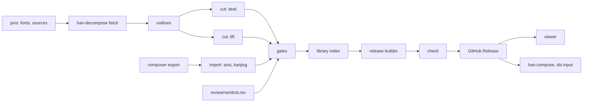

# han-decompose — design

Status, 2026-11-15: the format, the pinned inputs, the outline reader and its parity check are
built (phase 0 and the first half of phase 1 in section 7). The cutters, the release builder and
the viewer are planned as written here. Section 9 lists what has been decided.

han-decompose records, for each character a font draws, which of the glyph's outlines belong to
which component of its IDS description. Every part is a set of contours the font already draws;
no seam is invented. The same record serves three uses: a host library for composition, a variant
library of component and character forms, and a reviewed data set for testing cutters.

Code is MIT. Outline data keeps the licence of the font it came from. Labels keep the terms of the
description source they were read from. [`licensing.md`](licensing.md) says which terms reach which
file.

## 1. Findings that shape the design

1. **Three cutters exist and address ink three ways.** The ids-input cutters (`build_donor_parts.py`,
   `build_mountain_instances.py`, `build_custom_cuts.py`) simplify the glyph with skia-pathops and
   work on untouching pieces, writing the simplified paths out. han-compose's cutter (`Composer._cut`,
   `kanjivg_cuts.py`) works on the font's raw contours and its export writes a cut as indices into
   the host glyph's contour list (`c.k` in `web_export.cut_record`). `build_custom_cuts.py` already
   maps pieces back to raw contours (`own()`, by half-area overlap) to match the export.
2. **Raw contours are the finer grain, and in the variable Noto faces much finer.** Measured on 1,500
   random Han glyphs per face (seed 1, 2026-11-15, the pinned fonts): simplification lowers the contour count
   in 1,474 glyphs of Noto Sans CJK JP VF 2.004 and 1,491 of Noto Serif CJK JP VF 2.003, where
   strokes are drawn as overlapping contours; in Plangothic P1 it lowers it in 28 and in Jigmo2 in 33.
   A piece is always a union of whole raw contours, so every existing cut can be written as a set
   of contour indices, and han-compose can cut inside a piece the ids-input cutters must refuse.
3. **The export's host entry mixes neutral facts with composer-specific ones.** Host, operator,
   operand index, box, frame, gap and contour set are facts about the cut. Rank `r`, sibling ink
   `si`, `v`, `j`, the 71 shape features `f` and the usual boxes `u` belong to one layout model
   version. `build_custom_cuts.py` re-implements the second group (`slot`, `Part.box`,
   `Contour.length`, `compose_layout.shape`, the int16 quarter-unit encoding) outside han-compose.
4. **Verdict keys are lossy.** The gallery keys a verdict by style, component and host; the donor
   review page by character. Neither names the contour set judged, so a rebuild that changes the
   cut silently inherits the verdict.
5. **Licences attach at different levels.** Outlines: SIL OFL 1.1 (Noto, Plangothic, GenZui, Kureedo,
   Zhuque), CC0 1.0 (Jigmo), Arphic Public License (BabelStone Han PUA). Labels: BabelStone IDS,
   CHISE IDS (GPL-2.0-or-later), Yi Bai's zi.tools table (MIT). KanjiVG (CC BY-SA 3.0)
   guides some cuts: its stroke groups say which contours go together, and the cut is contours of
   the font. GlyphWiki glyphs, free to use, check a cut.
6. **Gates are calibrated for one component.** The filled gate (1 − IoU ≥ 0.6081 at 64 px) and the
   skeleton gate (one-sided cut→reference distance ≥ 0.0499 at 128 px, no pruning) were tuned on
   山 (44 bad and 164 good hand labels in `analysis/mountain-fit/labels.json`, 55 confirmed bad in
   the sweep). The 口 survey applies 山's thresholds unchanged and refuses 4,626 instances; its
   false-refusal rate is unmeasured.

## 2. Data model

### 2.1 Vocabulary

| Term | Meaning |
|---|---|
| font | One pinned font file at one named instance (`wght=400` for a variable font). |
| glyph | One glyph of a font, selected by code point, variation sequence or glyph id. |
| contour | One closed contour of the glyph, in the font's own order. Contours may overlap. |
| piece | A maximal set of contours whose ink touches or overlaps, with the counters inside it. Derived, stored per glyph. |
| description | One IDS a source gives for a subject, kept exactly as the source writes it. |
| component | What a node of a description names: a character, a numbered component, a CHISE entity, an AJ1 CID, a stroke chain, or a subtree. |
| reading | One labelling of one glyph by one description: which contours go to which nodes. |
| cut | One node of a reading: a component, its path in the tree, its contour set, its evidence and checks. |
| form | A cut seen as a drawing of its component. Every cut is a form; one per component and font chain is marked as the chosen form. |
| library | For a component and a font chain, its cuts grouped by place. |
| verdict | A reviewer's Right or Wrong on one cut with one exact contour set. |

### 2.2 Identifiers

All identifiers are strings, stable across rebuilds while their inputs are unchanged.

**Font** — `<family-slug>@<version>`: `noto-sans-cjk-jp@2.004`, `noto-serif-cjk-jp@2.003`,
`plangothic-p1@2.9.5795`, `plangothic-p2@2.9.5795`, `jigmo@20250912`, `jigmo2@20250912`,
`jigmo3@20250912`, `babelstone-han-pua@1.472`. Each face of a collection is a font with a slug of
its own. The registry row holds file name, URL, SHA-256 (and archive SHA-256
plus member for Jigmo's zip), name-table version string, instance, units per em, licence, copyright
line, reserved font names, style class (`sans`, `serif`, `kaisho`, `fangsong`).

**Font chain** — a named, ordered list of fonts that one design is spread over: `sans` = Noto Sans
CJK JP, Plangothic P1, Plangothic P2; `serif` = Noto Serif CJK JP, Jigmo2, Jigmo3, Jigmo. A glyph
is taken from the first font in the chain that draws it. Libraries and chosen forms are per chain.

**Glyph** — `<font>/<selector>`: `U+50AC`, `U+845B.E0100` (variation sequence), `gid.1234`
(unencoded glyph). Region-specific drawings are separate fonts (JP, TC), so no locale selector.

**Source** — a short slug in the registry: `babelstone`, `chise`, `zi-tools`, `kanjivg`,
`glyphwiki`, `adobe-japan1`, `ids-input-components`. Each row holds URL, pin (release, commit or file date),
SHA-256 per file, retrieval date, licence, licence evidence URL, attribution line, and role
(`description`, `guide`, `reference`, `identity`).

**Description** — `<source>.<h8>`, `h8` being the first 8 hex digits of the SHA-256 of the IDS text
after the source's annotations are stripped by a rule the format states per source (BabelStone's
trailing region tags, zi.tools' notes). The record keeps the subject and the verbatim text.

**Component** — a typed reference, written compactly:

| Kind | Reference | Written in sources as | Notes |
|---|---|---|---|
| character | `u:5C71`, `u:845B.E0100` | 山 | Hex code point, optional variation selector. |
| BabelStone numbered | `bs:42` | `{42}` | Pinned to IDS.TXT's file date. PUA code point recorded per BabelStone Han PUA version, since it moves between versions. |
| CHISE entity | `chise:CDP-8958`, `chise:U-i001+20B36`, `chise:GT-K01234`, `chise:AJ1-01815` | `&CDP-8958;` | Entity name verbatim. |
| Adobe-Japan1 CID | `aj1:1815` | — | The glyph CHISE's `&AJ1-01815;` points at. |
| zi.tools chain | `zi:#(丿𠃊)` | `#(丿𠃊)` | Chain text verbatim. |
| subtree | `ids:⿱𰀪亻` | an inner node | A node no source names; the key han-compose uses for sequence operands. |

Relations between components live in `components.tsv`, one row per relation, each with its basis
and tier:

- `chise:AJ1-01815` `same` `aj1:1815` (basis: the entity's name; tier `source`).
- `aj1:1815` `glyph-of` `u:5F62` (basis: Adobe-Japan1 CID order, CIDs 1125–7477 follow JIS X 0208
  kanji order; tier `derived`). Cuts of the entity are then listed as glyph variants of 形.
- `chise:CDP-8958` `equivalent` `u:2E9D` (basis `difference` and status `verified` copied from
  ids-input's `custom-components.json.gz`, with its ledger id `X-00777` as a cross-reference; tier
  `derived`).

The registry holds 164 `&AJ1-NNNNN;` entities. Adobe's own table (adobe-type-tools/Adobe-Japan1
`aj17-kanji.txt`, version 2023-01-24, Ken Lunde and Masataka Hattori) maps every one of them: 118 are
the base glyph of a JIS X 0208 character (field 2, e.g. 1815 形 23-33, 1829 系, 2014 耕), 45 are later
Adobe-Japan1 additions that map to their own code point in the UniJIS CMap (13701 旣, 16955 灵), and 1
is an IVS (13763 = 工 U+E0101). So `glyph-of` rows can be generated from that table for all 164; the
table is pinned by commit and digest like the fonts.

**Cut** — `<glyph>~<description>~<path>`: `noto-sans-cjk-jp@2.004/U+50AC~babelstone.9d9dea39~1.0`.
The root is `-`. A cut also carries `sig`, the first 8 hex digits of the SHA-256 of its component
reference and its sorted contour indices; `id` + `sig` is what a verdict binds to.

### 2.3 Outlines

One record per glyph, in files that hold a single font:

- `contours`: the glyph's contours in font order after composites are decomposed, each
  `[commands, points]`. Commands use han-compose's letters: `M`, `L`, `Q<n>` (a TrueType quadratic
  run of n points), `Q<n>*` (closing on an implied point), plus `C` for a cubic. Curves stay as the
  font has them.
- `points`: flat integers, x and y interleaved, in hundredths of a unit on a 1000-unit em, y up.
  Every existing consumer works on that em; the font's own `upem` is in the registry. Trade-off:
  a font whose em is not 1000 (Jigmo, 1024) is rounded by at most 0.005 unit.
- `pieces`: the piece partition as lists of contour indices, so no consumer needs boolean
  operations. Rule: two ink contours join when their fills intersect with area above 1 unit²; a
  counter joins the smallest contour of opposite winding whose box holds it (han-compose's
  `_units` rule).
- `box`, `advance`.

Only glyphs that a reading or a reference names are written. Whole-font dumps are a non-goal.

### 2.4 Readings and cuts

A reading holds:

- `glyph`, `description`, `ids` (verbatim), `tree` (the description spelled out as far as the cut
  went: 催 `⿰亻崔` becomes `⿰亻⿱山隹`), `opened` (which nodes of `tree` came from a component's own
  description, with that description's id).
- `method`: `deal` (pieces dealt to operands by fingerprint and margin), `lift` (siblings lifted,
  the remainder kept), `axis` (han-compose's geometric cut), `kanjivg` (along KanjiVG groups),
  `hand` (a person chose the contours). With tool name, version and commit, and `grain`
  (`piece` or `contour`).
- `complete`: every contour claimed and every leaf present.
- `evidence` for the reading as a whole: `likeness`, `margin`, `redrawn`, `tried`.
- `cuts`: one per labelled node. Inner nodes are not stored where their contour set is the union of
  their children's.

A cut holds:

- `path`: operand indices into `tree` (`[1, 0]`), `place` (han-compose's slot: `L C R`, `T M B`, or
  operator plus index such as `⿸0`), `depth`, `level` (opened ancestors + 1), `whole` (its parent is
  the root, so it stands in the em where the designer put it).
- `component` and `text` (the node as written).
- `contours` (sorted indices), `sig`, `box`, `frame` (box of the parent node's ink), `gap`, `area`,
  `ink` (summed contour polygon length, as han-compose measures it).
- `evidence`: `fit` or `match`, `margin`, `agree` (other hosts leaving the same shape), `reference`
  (likeness to the GlyphWiki glyph, with that glyph's name and fetch date).
- `checks`: each `{value, limit, against, pass}` — `filled`, `skeleton`, `windows`; plus
  `calibrated` naming the component whose labels set the limits, or `false`.
- `status`: `accepted`, `refused` (a check failed), `reviewed-right`, `reviewed-wrong`.
- `licence`: `{outline, description, guide?}` as SPDX identifiers, repeated from the registries so a
  row stands alone in the TSV.

Tiers are explicit. The outline is the font's. The label is `machine`, `reviewed` or `hand`.
A relation in `components.tsv` is `source` or `derived`. Nothing derived is presented as attested.

Attempts that closed no reading are kept in `skipped`, one row per glyph and description, with a
reason code (`too-few-pieces`, `unlike-element`, `layout-mismatch`, `ambiguous`, `does-not-tile`,
`no-reference-glyph`, `no-enclosure`, `no-face`, `too-many-pieces`) and the builder's sentence.

### 2.5 Libraries, forms, variants

These are indexes over cuts and hold no geometry of their own.

- `library/<chain>.json.gz`: component → place → cut ids, best evidence first, with `usual`
  (mean box, spread, count) per place. A cut enters when its status is `accepted` or
  `reviewed-right`.
- `forms/<chain>.json.gz`: component → the chosen cut and its basis (`reference`, `agree`,
  `single`, `hand`), following the rule `build_custom_cuts.py` uses today.
- Variants: a character page lists the character's own glyph in each font, every cut whose
  component is that character (the character as drawn inside others), and every cut of a component
  related to it in `components.tsv` (`glyph-of`, `equivalent`), each labelled with the relation.

Layout features, host ranking and weight masters are left to han-compose (section 5).

### 2.6 Verdicts

`review/verdicts.tsv`, committed: `cut_id`, `sig`, `verdict` (`right`, `wrong`), `note`,
`reviewer`, `at`, `release`. A verdict whose `sig` no longer matches the built cut is reported as
stale and applies to nothing.

## 3. File format

[`format.md`](format.md) defines the files and `schema/1/han-decompose.schema.json` states the same
structure for machines. What shaped them:

- An outline file holds one font and carries that font's licence and copyright line. A cut file
  holds one font and one description source, contains indices and labels only, and lists the
  source's terms. OFL or CC0 outline data and GPL-informed labels are thereby in separate files.
- The flat tables are written per description source for the same reason.
- Blocks of 256 code points keep shard names readable and let a character page fetch two small
  files.
- Every JSON file is UTF-8 with sorted keys and fixed separators, gzip has its modification time
  at 0, and no file holds a build date, so a rebuild gives the same bytes.

## 4. How each existing source maps in

| Source | Becomes | Lacks today |
|---|---|---|
| ids-input `data/donor-parts.json` (114 of 138 stacks on 山; BabelStone; Noto then Jigmo) | Complete readings, method `deal`, grain `piece`; `parts` → leaf cuts, `first`/`terminal`/`recursive` → inner nodes derived from leaves | Contour indices (paths are pathops output); node paths (leaves are told apart by label and counting); per-part scores (one `likeness` per character); description id. Its chain puts Jigmo's mincho under a sans face. |
| `mountain-instances.json.gz`, `component-instances-口.json.gz` (山: 2,220 instances in 2,150 of 2,926 characters; 口: 5,033 in 4,731 of 26,446) | Readings with `tree`, `opened`, `level`; `route` → `path`; `fit`, `disagreement`, `skeletonAway` and their `…Against` → evidence and checks; `skipped` → skipped rows; `shallower` and `closed` → the reading's depth and the reason the deeper one failed | Contour indices; the other operands' hands (dealt, then dropped); reason codes (free text carrying face and depth); calibration marker for 口; the 口 file still says `ids-input/mountain-instances`. Hand labels live apart in `analysis/mountain-fit/labels.json`, keyed `char#index`. |
| `strokes` and `tiling` in the 山 file (`split_mountain_strokes.py`) | Out of scope: the neck cut draws seams the font does not | — |
| han-compose `js/src/component-forms.json` (hand cuts by IDS text and style, `positions`, `editorial`) | Pure contour selections → readings, method `hand`, component `ids:<text>`, `positions` → cuts with a named place note. Editorial compositions stay in han-compose | Host glyph per form (only `editorial.donors`); contour indices; description source; evidence. Cut from static collection faces (SHA `b76b0433…`, `93069d8e…`), a different file from the variable fonts the other cutters pin, so indices have to be re-derived by matching outlines. |
| `data/numbered-forms.json`, `numbered-sans-outlines.json.gz`, `numbered-five-context.json` | 69 `bs:N` components: the PUA glyph as a glyph of `babelstone-han-pua@1.472` (the reference shape, and the serif and kaisho form); the Sans cuts as `lift` cuts; `{5}` from 葭 as a cut at place `L` | Host and face of each Sans cut; scores; the `{N}`↔PUA map (keys are PUA characters); which nine fell back is listed, why is not. |
| `data/custom-forms.json.gz` v2 (`forms`, `hosts`; Sans 446 entities and 7 chains, Serif 296 and 1; 353 and 189 host cuts) | Each form and each host entry → a `lift` cut in a reading of its host; `from`/`recipe`/`match`/`margin`/`agree`/`reference`/`single` → evidence and the form's basis; `hosts[style][text][place]` → library index | Contour indices (`c.p` is the simplified outline re-encoded, heavy delta zero); the face of a library entry (only `v`, first face or not); the description used; the lifted siblings as cuts of their own; failed hosts (only `tried`). `record.f`, `record.u`, `si`, `r`, `v`, `j` are composer fields and do not move. |
| han-compose export host index (`p/` shards: `entry_record`, `cut_record`) | Bulk import: `c.k` → `contours` directly; `kv` → method `kanjivg`, else `axis`; `c: null` → skipped | Evidence and checks; reasons for a null cut; description ids (its sequences come from its own vocabulary). Entries with `c.p` (a contour the glyph does not have) are left out. |
| `kanjivg_cuts.py` | Method `kanjivg`, `guide: kanjivg`, `licence.guide: CC-BY-SA-3.0`; the cut file carries KanjiVG's attribution | — |
| `build_custom_cuts.py` | Its `recipes`, `Face`, `cut`, `settle` → the `lift` cutter. Its `entry_of`, `record_of`, `part_of`, `form_of` → deleted; han-compose computes those from han-decompose cuts | — |
| The review gallery page; `demo/donor-review.js`; `tests/fixtures/donor-parts-reviewed.json` | The review page; verdicts imported into `verdicts.tsv`; the 25 reviewed characters → regression fixtures | Binding to a contour set; reviewer; release. Gallery verdicts sit in the page's database or in one browser's storage. |
| ids-input `custom-components.json.gz`, `custom-ids.tsv`, `custom-outlines.json.gz` | Pinned inputs: equivalences and `X-` ids → `components.tsv`; GlyphWiki outlines → `references/` | The registry is GPL-2.0-or-later and derived, so its rows are tier `derived`. |

## 5. Repository, pipeline, releases

### 5.1 Layout

```
han-decompose/
  README.md  LICENSE
  docs/            format.md (normative), design.md, licensing.md, parity.md
  schema/1/        han-decompose.schema.json, the one definition both languages read
  pins/            fonts.json  sources.json  README.md (written from the two)
  src/han_decompose/   the Python package and the `han-decompose` command (uv)
    identifiers.py schema.py tsv.py pins.py outline.py
    ids.py descriptions.py pieces.py            planned
    cutters/  deal.py lift.py survey.py         planned
    gates/    filled.py skeleton.py             planned
    importers/ composer_export.py               built: the parity check
    release.py                                  planned
  analysis/        gate tuning and the studies behind the limits, planned
  review/          verdicts.tsv, fixtures, planned
  packages/format/ the reader for JavaScript; unpublished
  tests/
```

### 5.2 Pipeline



### 5.3 What moves, what stays

Moves into han-decompose:

- ids-input `feat/donor-parts`: `build_donor_parts.py` (geometry, fingerprints, `Cutter`),
  `build_mountain_instances.py` (`Enclosing`, spelling out, routes, both gates, generalised from
  `MOUNTAIN` to any component), `check_mountain_instances.py`, `test_donor_parts.py`, the reviewed
  fixture, and `analysis/` with its READMEs. The demo pages are replaced by the viewer.
- ids-input `build_custom_cuts.py`: the cutting half.
- han-compose `docs/design/part-extraction.md` → `docs/method.md`.

Stays and consumes:

- han-compose keeps its cutter. It is entangled with drawing (`_kept`, `_traded`, `_like_fellows`,
  parity sets) and already addresses contours by index. It publishes through the importer and
  gains one adapter that reads a han-decompose release and builds host entries and key records with its
  own `entry_record`, `key_record`, `slot` and `shape`. `custom-forms.json.gz` format v2 and
  ids-input's writer into the han-compose checkout are deleted in the same change.
- ids-input keeps `build_custom_components.mjs`, the `X-` ledger, `build_custom_outlines.mjs` and
  `split_mountain_strokes.py`. It drops the cutters, `donor-parts.json`, the instance files and
  their pages, and reads forms and variants from a pinned han-decompose release.
- IDS parsing: han-decompose has one Python parser for the three notations. The JavaScript reader
  ships no parser; every cut row carries its resolved `component`, `text` and `path`.

Trade-off: han-decompose reads ids-input's component registry while ids-input reads han-decompose
releases. Each side pins the other by SHA-256, and han-decompose needs the registry for
`components.tsv` and for the list of components to lift, never for the cutting itself.

### 5.4 Reproducibility

- Fonts and sources are pinned by SHA-256 in `pins/`, fetched into a user cache, verified on every
  read; a mismatch stops the build. A file whose upstream address is replaced in place (IDS.TXT, BabelStone Han PUA) has a
  mirror that serves the pinned bytes: an archived copy, or an asset of this repository's releases.
- Tools are pinned in `uv.lock`.
- Output is deterministic: integer coordinates, sorted keys, fixed separators, gzip mtime 0,
  results merged in code point order whatever the worker count, no dates in data files.
- Published cuts are index sets, so pathops numerics reach the data only through which contours
  join a piece; simplified paths are never written.
- The check validates every file against the schema, asserts the invariants (contours exist,
  cuts of a reading are disjoint, `complete` is true to its definition, every row has licences),
  rebuilds and compares SHA-256 with the manifest, and reports stale verdicts.
- `han-decompose parity` decodes every glyph record of a han-compose export and requires the same
  contours in the same order as the outline read here ([`parity.md`](parity.md)).

### 5.5 Versioning and release

- Format: `major.minor` in every file's `format` field.
- Data: `vMAJOR.MINOR.PATCH`. MAJOR follows the format. MINOR is a change in fonts, sources or
  cutters. PATCH is verdicts and status only. Cut ids hold across releases while the font pin and
  the description text hold; a new font version is a new font id.
- Release, run locally: full build, the check, a diff report against the previous release
  (cuts added, removed, changed; verdicts gone stale), tag, then `gh release create` with one
  archive per font and source, the flat tables, registries, a README naming every source and
  licence, `manifest.json` and `SHA256SUMS`. CI runs unit tests, the type check and the build only.
- Consumers pin a release URL and digest the way they pin a font.

## 6. Viewer

The viewer is built after the data phases and the first release.

Svelte 5 and Vite, served as static assets from Cloudflare, with data fetched as release shards.
SvelteKit with the Cloudflare adapter gives routing and leaves room for an endpoint later; a plain
Vite app with a small Worker, as ids-input's workshop uses, is the lighter alternative.

| Route | View |
|---|---|
| `/` | Search by character, component notation or font. |
| `/char/U+5D14` | The glyph in each font with its cuts coloured by node; readings per description source; the character as cut out of other characters; related variants with their relation. |
| `/component/<ref>` | The chosen form per chain; the library by place; all cuts sortable by evidence and size; the reference glyph; equivalents in other notations. |
| `/font/<id>` | Pin, licence, coverage, readings by method and status, skipped by reason. |
| `/review` | A queue of proof-sheet rows: host pieces one colour each, kept and lifted, the part alone, the reference; Right and Wrong; filters for font, source, method, basis and verdict; weakest first. |
| `/skipped` | Attempts without a reading, by reason. |

Labels, values and actions carry the pages; method notes sit in a help panel and in `docs/`.

**Verdicts.** First stage: review runs on a local dev server whose middleware appends to
`review/verdicts.tsv`; the file is committed by PR. The hosted site shows verdicts read-only.
Later, if a second reviewer appears: a Worker endpoint with D1 behind sign-in, exported to the
same TSV by PR. The TSV in the repository stays the record either way.

**Feedback.**

1. `wrong` withholds the cut from libraries and forms; the row stays in the data as
   `reviewed-wrong`.
2. `right` keeps a cut even where a gate refused it, and records the gate's false alarm.
3. Verdicts are the labelled set for gate tuning. `analysis/gate-tune` reads them per component
   and writes limits to `gates.json` with their basis (labels used, AUC, held-out result).
   A component without labels uses the default limits and its cuts say `calibrated: false`.
4. `reviewed-right` cuts become fixtures a rebuild must reproduce.
5. A stale verdict returns its cut to the queue.

## 7. Phased plan

Each item is one PR. Publishing a release or the site needs its own go-ahead. The data comes
first: the cutters and a large library, then a release, then the viewer.

**Phase 0 — ground (built)**
- 0.1 Scaffold: licences, README, uv project, CI (tests, type check, build).
- 0.2 `docs/format.md`, the schema, golden files for one character, validation.
- 0.3 `pins/` and `han-decompose fetch` with digest checks; `docs/licensing.md`.

**Phase 1 — outlines**
- 1.1 Contours and integer points (built); parity with han-compose exports (built).
- 1.2 Pieces with their contour indices; outline shards.

**Phase 2 — the dealing cutter**
- 2.1 IDS parser for the three notations, the description tables, spelling out.
- 2.2 `deal` writing contour sets; the 114 stacks on 山 reproduce.
- 2.3 Component survey with both gates; 山 reproduces 2,220 instances in 2,150 characters.
- 2.4 口, with `calibrated: false`, and the reason codes.

**Phase 3 — the lifting cutter and identities**
- 3.1 `lift` with forms and libraries; the form counts and the 353 and 189 host cuts reproduce.
- 3.2 Numbered components and the PUA reference glyphs.
- 3.3 `components.tsv`: the Adobe-Japan1 rows, then registry equivalences.

**Phase 4 — the library and the release**
- 4.1 Every description of the three tables, both chains; refused and skipped rows kept.
- 4.2 Release builder: files per font and source, tables, README, checksums; first tagged release.

**Phase 5 — viewer**
- 5.1 Scaffold and character page. 5.2 Component page. 5.3 Font and skipped pages.
- 5.4 Review mode with the local verdict file and the import of existing verdicts and labels.
- 5.5 Cloudflare configuration.

**Phase 6 — consumers**
- 6.1 han-compose: the adapter; format v2 removed.
- 6.2 ids-input: cutters, their data and pages removed; a release pinned.
- 6.3 Composer export importer (`axis`, `kanjivg`).

**Later** — dealing at contour grain inside fused pieces of the variable faces; hand forms;
hosted verdicts; more chains (kaisho, fangsong); a stroke layer; publishing the JavaScript reader
to npm.

## 8. Risks

1. **Licence composition.** Whether OFL outline data and GPL-informed labels may share a file is
   uncertain; the split of files and tables per source avoids the question without settling it.
   Arphic-licensed PUA outlines and KanjiVG-guided cuts add two more terms. Noto Sans CJK reserves
   the font name "Source".
2. **Contour order.** Indices hold only for the exact file, instance and decomposition order. The
   parity test covers the variable Noto faces and Plangothic; collection faces and CFF outlines
   are untested.
3. **Uncalibrated gates.** Only 山 has labels. Limits borrowed for other components refuse and
   accept at unknown rates until reviewed.
4. **Scale.** Dealing tries every division of a glyph's pieces; all descriptions over two chains is
   hours of batch work, and the composer import adds cuts by the hundred thousand. Release size
   and asset count on the host need measuring at phase 4.
5. **Review capacity.** Most machine cuts will never be seen by a person. Status and calibration
   are shown on every cut so unreviewed data is never mistaken for checked data.
6. **Derived identities.** Cross-notation equivalences and the AJ1 `glyph-of` relation are
   inferences. None of the pinned fonts is keyed to Adobe-Japan1, so no outline here verifies that
   a cut matches the CID's glyph.
7. **Mutual pins** between han-decompose and ids-input can drift.
8. **Verdict migration.** Old verdicts name no contour set; each has to be matched to a rebuilt
   cut by host, component, face and box, and dropped where that fails.
9. **pathops across platforms.** Piece membership near the 1 unit² threshold could differ between
   builds of Skia; the check rebuild runs on the release machine only.
10. **Name.** An existing repository of the same owner differs from this name by one word and
    holds an unrelated data set of characters in page images.

## 9. Decided

Decided by the project's owner on 2026-11-15, the first group before the repository was created
and the second after phase 0.

1. The name han-decompose, beside han-compose, han-input and han2ids.
2. Code under MIT; each data file under its source font's licence, with its description sources'
   terms listed.
3. One repository with a static viewer and versioned data releases.
4. The first release covers the `sans` and `serif` chains and every source: 山 and 口, numbered
   components, zi.tools chains, CHISE entities and the Adobe-Japan1 glyph variants.
5. Refused, reviewed-wrong and skipped rows ship, marked by status.
6. Verdicts live in the repository as TSV.
7. Coordinates are hundredths of a unit on a 1000-unit em.
8. The stroke layer is out of scope.

Then:

9. **KanjiVG.** It guides cuts and the data does not derive from it. Guided cuts ship, with
   KanjiVG's attribution and its share-alike terms on the files that hold them.
10. **Flat tables.** Written per description source at release time.
11. **BabelStone Han PUA.** The reference shape of a numbered component, and its form in the serif
    and kaisho styles, under the Arphic Public License. The pinned file is mirrored as a release
    asset of this repository.
12. **GlyphWiki.** Free to use, cited with its address, kept as a check.
13. **Adobe-Japan1.** The `glyph-of` rows are generated from `aj17-kanji.txt` for all 164 entities.
14. **npm.** The JavaScript reader is not published for now. The data and a large library come
    first, the viewer after them.

Open: hand and editorial forms (migrate the pure selections, leave the compositions); a hosted
verdict store and whether the reviewer's handle is recorded; the site's domain and whether shards
are served as assets or from object storage.

## Sources read

- ids-input, branch `feat/donor-parts` with its working tree of 2026-11-15:
  `scripts/build_donor_parts.py`, `build_mountain_instances.py`, `split_mountain_strokes.py`;
  `analysis/gate-tune/README.md`, `analysis/mountain-fit/labels.json`; `data/donor-parts.json`,
  `mountain-instances.json.gz`, `component-instances-口.json.gz`, `component-instances.json`,
  `mountain-skeleton.json.gz`, `unicode-fonts.json`, `data/README.md`; `demo/donor-review.js`,
  `demo/component-instances.js`; `tests/fixtures/donor-parts-reviewed.json`.
- ids-input `main`: `data/README.md`, `custom-components.json.gz`, `chise-sources.json`,
  `custom-outlines.json.gz`, `ids-components.tsv`, `zi-tools-chains.tsv.gz`,
  `scripts/build_custom_cuts.py`.
- han-compose `main`: `js/src/component-forms.json`, `component-forms.js`, `custom-forms.js`;
  `data/numbered-forms.json`, `numbered-sans-outlines.json.gz`, `numbered-five-context.json`,
  `custom-forms.json.gz`, `data/README.md`, `data/sources/hfhchan-ids.yaml`;
  `src/han_compose/web_export.py`, `compose.py`, `compose_layout.py`, `kanjivg_cuts.py`;
  `docs/design/part-extraction.md`.
- The review gallery page of the custom-component cuts and the script that fills it.
- Contour counts before and after simplification: 1,500 Han glyphs per face, seed 1, run
  2026-11-15 against the pinned fonts.
- Adobe-Japan1: `aj17-kanji.txt`, version 2023-01-24 (Ken Lunde and Masataka Hattori), at commit
  `b42b377d7efbc233ae2a4c1833947e04760e68d1` of adobe-type-tools/Adobe-Japan1.
- GlyphWiki's licence page in its English translation, as archived on 2025-11-14:
  <https://web.archive.org/web/20251114152951/https://en.glyphwiki.org/wiki/GlyphWiki:License>.
